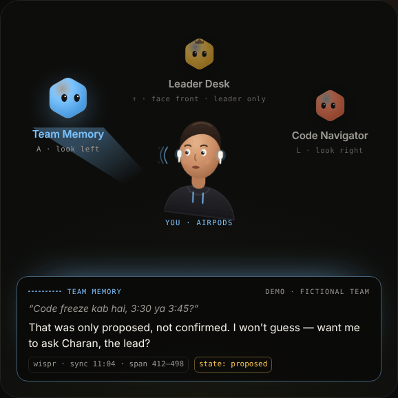
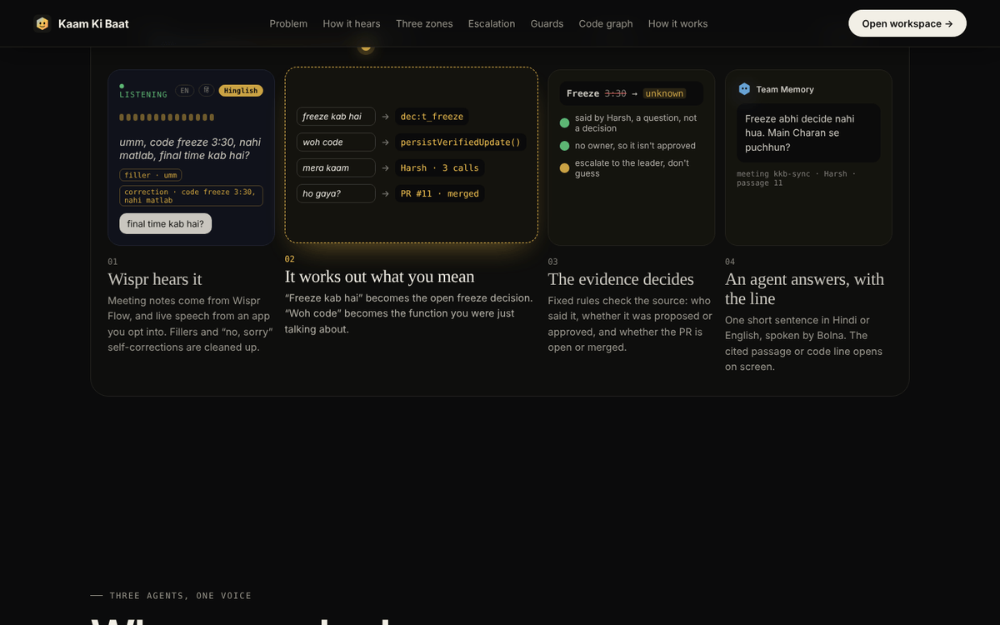

# Kaam Ki Baat

A voice teammate that connects what a team agreed in a meeting with what its GitHub repository shows, then helps each teammate take the next useful action.

**Stage:** the application core, four runtime tools, evidence specialists and GitHub adapter are implemented. Current demo work and exact verification results are tracked in [the plan](docs/plan.md). Real calls, agent changes, deployment, and merging each need a separate instruction.

> **Meeting mein bola. Repo mein bana?** *(Said in the meeting. Built in the repo?)*

## The problem

Teams decide things out loud and then lose them. A week later nobody can say who owns a task, whether the code exists, whether it merged, or whether the tests passed on the latest commit. So someone pings the lead and waits, or guesses, and the guess ships.

- **55%** of people say next steps are unclear when a meeting ends ([Microsoft Work Trend Index 2023](https://www.microsoft.com/en-us/worklab/work-trend-index/will-ai-fix-work), 31,000 workers).
- **69%** of developers lose 8+ hours a week to inefficiencies ([Atlassian × DX, State of DevEx 2024](https://www.atlassian.com/blog/development/developer-experience-report-2024)).
- **61%** of developers spend 30+ minutes a day searching for answers; 53% say waiting on answers disrupts their flow ([Stack Overflow Developer Survey 2024](https://survey.stackoverflow.co/2024/professional-developers)).

## What it does

Call it and ask, in Hindi, English or both. Three agents sit around you; a head turn (AirPods or webcam), a tap, or the **A** / **L** keys picks one:

| | Agent | Answers | Never does |
| --- | --- | --- | --- |
| ← left | **Team Memory** | what was decided, by whom, with the exact meeting line (Wispr MCP) | guess — unknowns become a question for the lead |
| ↑ front | **Leader Desk** | the lead's inbox of open questions; approvals are versioned and read back | open for anyone but the lead, on their own device, with Touch ID |
| right → | **Code Navigator** | the exact file, function and lines at a pinned commit, from a graph of this repo, with the reasoning | edit, merge or deploy |

| You ask | The agent answers |
| --- | --- |
|  |  |

**Rules it won't break:** proposed is not accepted · an open PR is not merged · a test on an older commit is stale · "saved" only after the change is read back · a head turn only selects, it never proves who you are.

Live site: <https://kaam-ki-baat-one.vercel.app/> · Demo meeting and three-call test plan: [docs/demo/meeting-notes.md](docs/demo/meeting-notes.md)

**How the codebase grew:** [`/story`](https://kaam-ki-baat-one.vercel.app/story) shows every merged PR on one line, with lanes for Team Memory, Leader Desk, Code Navigator and the rest. Ask "who approves when the leader wasn't clear?" and it traces PR #9 → #11 → #16 → #18, in sentences the voice agent can read out (`GET /api/story?q=…`). Rebuild with `npm run story`.

### Deploy your own copy on Vercel

The button copies this repo into your GitHub account and deploys it to your Vercel; after that, every push to your copy's `main` redeploys. The landing page, `/story` and `/graph` need no environment variables. Live calls and the board need the keys in `.env.example`. To keep the original project in sync instead, set `VERCEL_TOKEN`, `VERCEL_ORG_ID` and `VERCEL_PROJECT_ID` as repository secrets and `.github/workflows/deploy-vercel.yml` deploys every merge to `main`.

## Start here (plain version)

1. Read [architecture.md](docs/architecture.md). It explains the problem, the direction, and the build order.
2. Read [integration-design.md](docs/integration-design.md). It explains exactly how Wispr Flow and Bolna connect to the system.
3. Read [decisions.md](docs/decisions.md). It lists every decision, whether it is confirmed, and what is still open.

## Working with coding agents

Start with [AGENTS.md](AGENTS.md) for the required instruction reads, implementation and Git checks, contributor coordination, and handoff workflow. [CLAUDE.md](CLAUDE.md) directs Claude clients to the same instructions. Keep [the plan](docs/plan.md) current as work progresses; verify its status against the checkout before acting.

## Project notes

- [Context](docs/context.md): purpose, proposed MVP, and open decisions.
- [Instructions](docs/instructions.md): current working constraints and acceptance principles.
- [Plan](docs/plan.md): completed preparation and future milestones.
- [MCP integrations](docs/integrations.md): endpoints, authentication, and verified connection status.
- [Tool recommendations](docs/tool-research.md): tools to use for setup, debugging, and the future voice runtime.
- [Code context](docs/code-context.md): optional Graphify retrieval linking meeting tasks to pinned code and dependencies.
- [Workspace setup](docs/workspace-setup.md): public/private GitHub access, passkey settings and required APIs.
- [Competition rules](docs/competition.md): verified schedule, strict call duration, and submission requirements.
- [Evaluation pipeline](docs/evaluation-pipeline.md): stored call evaluations and reviewed improvements between calls.
- [Handoff references](docs/reference/README.md): retained architecture, contracts, UX, and evaluation details.

## Development setup

The application uses Next.js and TypeScript with a local append-only JSONL store. Run `npm ci`, `npm test`, `npm run typecheck`, and `npm run build`. Copy `.env.example` to ignored `.env.local` and supply random server keys before starting the app. Meeting import, live calls and evaluations have their own verification gates; see [voice setup](docs/bolna/agent.md).

Use **Kaam Ki Baat** as the project name everywhere. The repository is [harshsinha-12/kaam-ki-baat](https://github.com/harshsinha-12/kaam-ki-baat).
