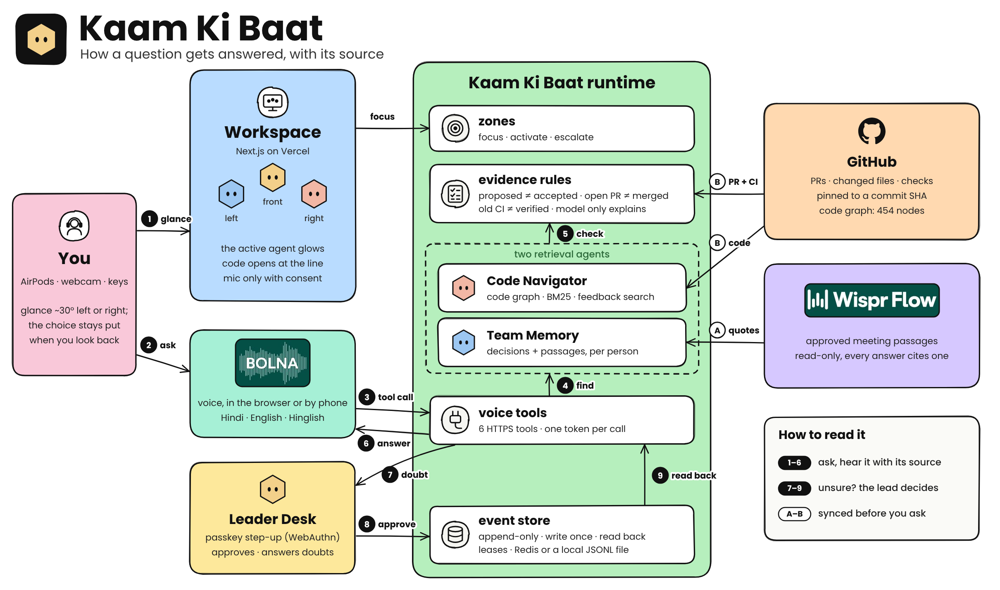
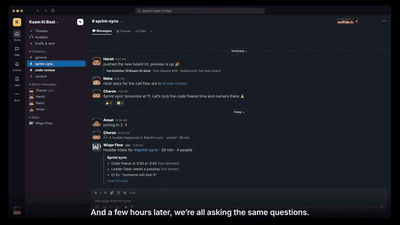
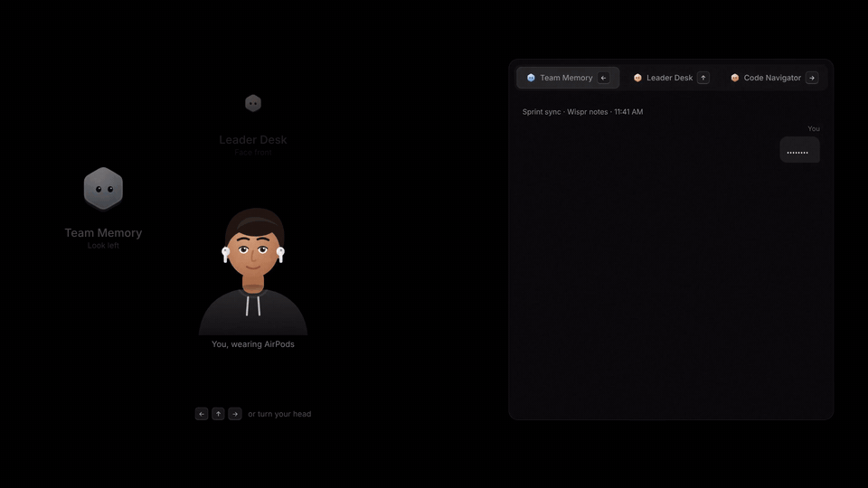
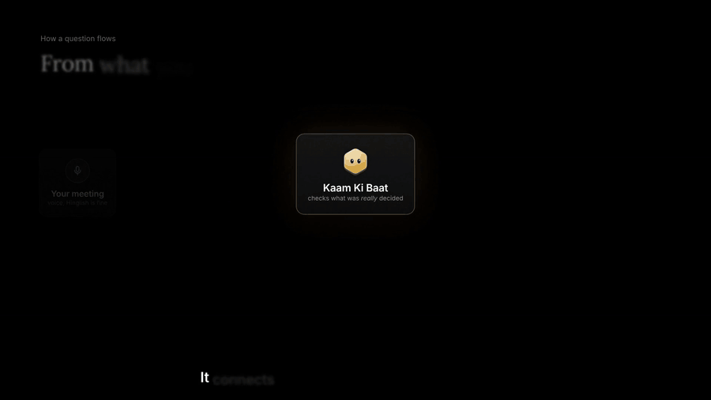
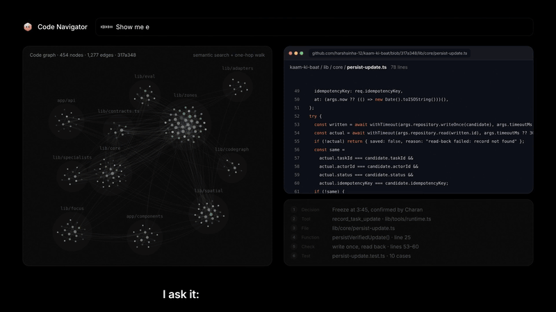
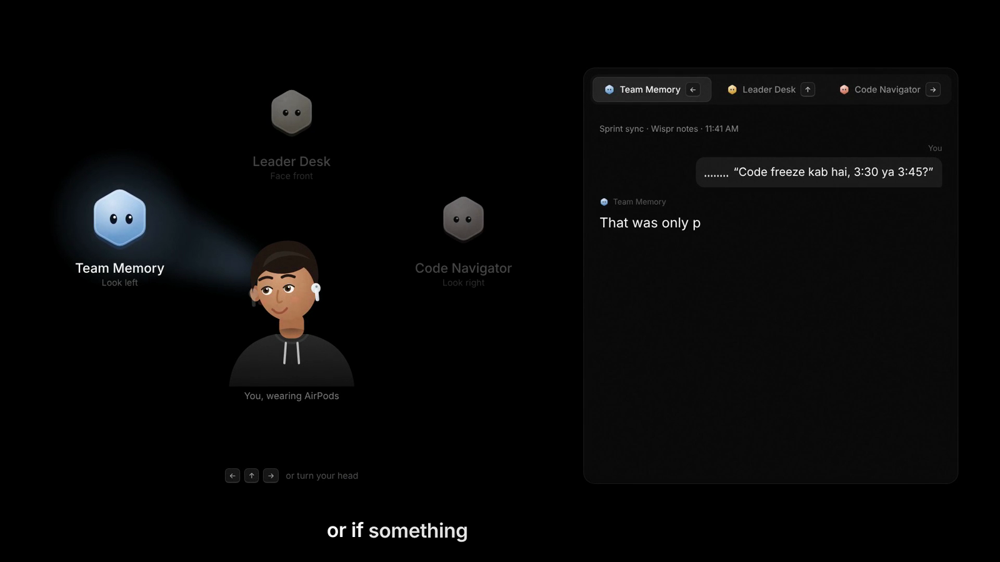
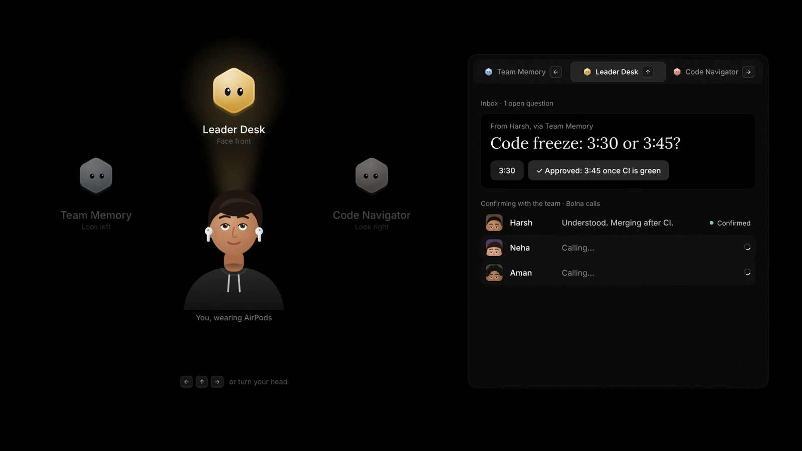
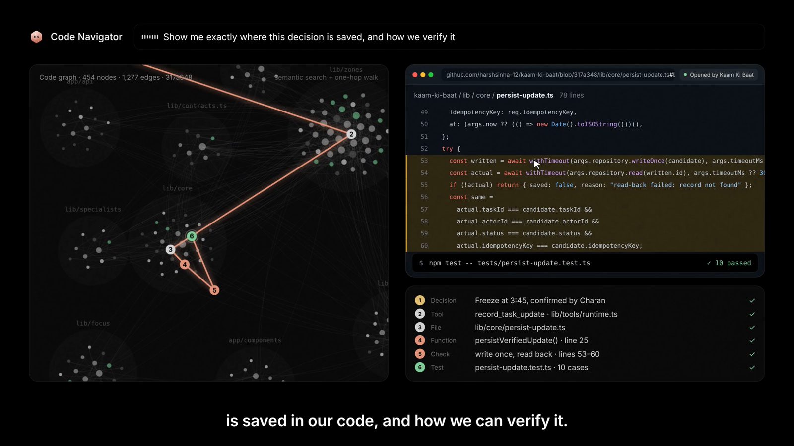
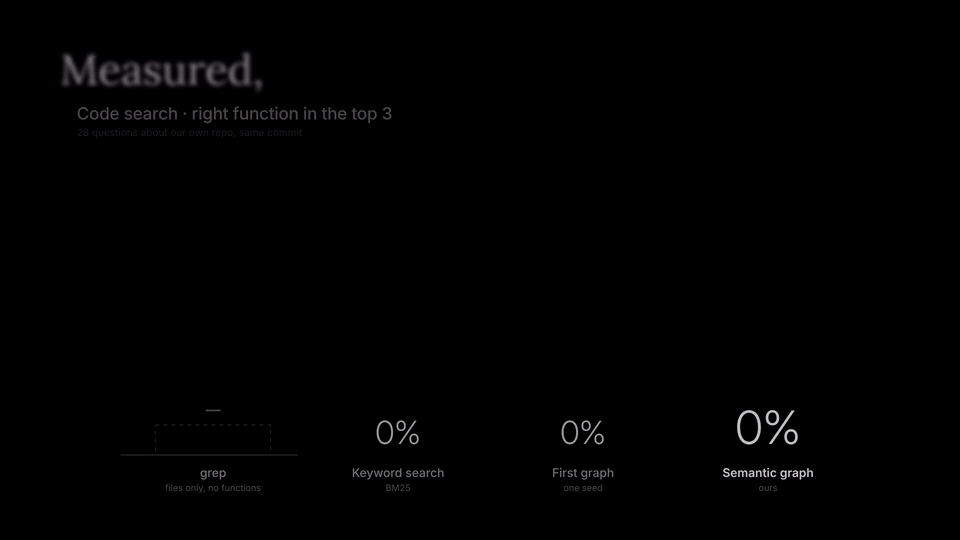

# Kaam Ki Baat

**Meeting mein bola. Repo mein bana?**

A voice teammate for engineering teams. Glance left to ask what the team decided, face the screen to reach the lead, glance right to land on the exact line of code. Every answer comes with its source, and nothing is called "saved" until it has been read back.

[Live site](https://kaam-ki-baat-xi.vercel.app) · [Workspace](https://kaam-ki-baat-xi.vercel.app/team) · [Architecture](docs/architecture.md) · [Evals](#evals) · [Run locally](#run-locally)



Follow the numbers. **1–6** you ask and hear the answer with its source. **7–9** if the agent is unsure, the lead decides and it is saved and read back. **A** and **B** are synced before you ask.

## The problem

Teams decide things in meetings and then lose them. Hours later the questions start in Slack: *what did we actually decide? who owns it? did it make it into the code?* The person who knows is in another meeting, so people guess, and guesses ship.

 

68% of people say they lack uninterrupted focus time, 57% of the workday goes to meetings, chat and email, and 55% say next steps after a meeting are unclear ([Microsoft Work Trend Index 2023](https://www.microsoft.com/en-us/worklab/work-trend-index/will-ai-fix-work)). 61% of developers spend more than 30 minutes a day searching for answers ([Stack Overflow Developer Survey 2024](https://survey.stackoverflow.co/2024/professional-developers)).

## How it feels

When we are stuck, we look left and right for help. Kaam Ki Baat puts an agent in each direction.



| Look | Agent | Ask it |
| :--- | :--- | :--- |
| ← left | **Team Memory** | "What did we decide?" It answers from approved meeting passages, says when something was only proposed, and offers to ask the lead instead of guessing. |
| front | **Leader Desk** | Lead only, behind a passkey. Approves or corrects a decision; the new version is written once and read back. |
| right → | **Code Navigator** | "Where is that in the code?" It walks the repo's code graph to the file, the lines and the test, pinned to a commit. |

**Glance and latch.** A natural 30 to 40 degree glance selects a side within about a third of a second, and the choice stays selected when you look back at the screen, so you never have to hold your head turned while you talk. Facing the screen for four seconds, or pressing ↑, returns to the Leader Desk. Head pose only *selects* an agent; it never proves who you are. Webcam, native AirPods motion and the arrow keys all drive the same selector ([`lib/focus/selector.ts`](lib/focus/selector.ts), mirrored in [`native/airpods`](native/airpods)).

## How a question flows



1. **Wispr Flow** supplies reviewed, consented meeting passages through a read-only import. Each passage keeps its speaker and character range.
2. **GitHub** supplies PRs, changed files and check runs, each pinned to a commit SHA, plus a code graph of the repository (454 nodes, 1,277 edges at the indexed commit).
3. **Fixed rules decide status**, not the model: proposed is not accepted, an open PR is not merged, a check on an older commit is stale. The language model only explains.
4. **Bolna** carries the voice, in the browser or on a phone call, and calls six authenticated HTTPS tools mid-sentence ([`lib/tools/runtime.ts`](lib/tools/runtime.ts)).
5. Unknown answers become **questions for the lead**. The approved answer comes back with its source, even if you hung up in the meantime.



| Team Memory | Leader Desk | Code Navigator |
| :---: | :---: | :---: |
|  |  |  |

*Product visuals are frames from the launch film, rendered from the same flows the app implements; demo conversations are fictional.*

## Evals

Numbers from our own repository and calls, built by the team that wrote the code, so read them as a regression guard rather than a public benchmark. Full reports: [code search](docs/evals/code-search.md), [Team Memory](docs/evals/team-memory.md).



**Code search (Code Navigator).** Metrics follow repository-level retrieval practice: function accuracy and recall at k, MRR and nDCG@10, with bootstrap 95% intervals ([CoIR](https://arxiv.org/abs/2407.02883) and the graded nDCG@10 protocol of CoREB). The method is lexical-semantic: BM25 over symbols, concept expansion, one hop of graph propagation and pseudo-relevance feedback. It runs offline in the browser with no embeddings.

| Question set | n | Keyword (BM25) Acc@5 | Ours Acc@5 | Ours MRR@10 | Ours nDCG@10 |
| :--- | ---: | ---: | ---: | ---: | ---: |
| Development (used to tune) | 28 | 46% | 100% | 0.68 | 0.72 |
| Hinglish and colloquial stress | 14 | 36% | 71% | 0.40 | 0.44 |
| Earlier held-out | 12 | 17% | 42% | 0.20 | 0.25 |
| **Fresh test, written before this round of tuning** | 22 | 50% | **77%** | 0.45 | 0.55 |

On the fresh test set the change in this round moved Acc@5 from 64% to 77% and nDCG@10 from 0.51 to 0.55. The held-out gap shows where lexical search stops: questions that share no words with the code. One caveat: the same people wrote the test questions and the search changes.

**Team Memory.** Question types follow the five long-term memory abilities in [LongMemEval](https://arxiv.org/abs/2410.10813) (ICLR 2025): extraction, multi-session, temporal reasoning, knowledge updates and abstention. A conflict category follows [MemoryAgentBench](https://openreview.net/pdf?id=ea2b7a90e40507191ac122fb5aabc382faa44318) (ICLR 2026), and a privacy-scope category checks per-person visibility. The safety numbers matter most: across 35 questions there were **0 false confirmations and 0 out-of-scope passages**. Abstention, conflict, scope, knowledge-update and Hinglish questions are all correct; reworded questions that share no words with the meeting reach 75% on the dev set and **33% on a blind set**, which is the honest limit of word matching and the reason the next step is embedding re-ranking.

**Tests.** 148 to 223 passing tests across the hackathon day on GitHub Actions with zero failures, now 230+ including torn-write recovery, concurrent tool calls and the glance-and-latch selector.

**Calls.** Seven real Bolna attempts, each with a written review: three phone calls (48 s, 94 s, 50 s; the 94 s call ended with a voice-provider error) and four browser attempts. See [`/evals`](https://kaam-ki-baat-xi.vercel.app/evals).

## What makes it different

- **Where you look is the interface.** Three agents are placed in space, like teammates around a desk. Choosing one is a glance, not a menu.
- **Proposed is not decided.** Status comes from fixed rules over evidence. The model is never allowed to promote "someone said maybe" into "confirmed".
- **Saved means read back.** Every write is idempotent, written once and read back before the agent says "saved". A timeout is a failure.
- **Scoped by person.** Each teammate only sees the meeting passages tied to their own tasks; the lead's private items never leak into a member's answer.
- **The lead stays in the loop.** Unknowns become tickets for the lead, approved behind a passkey, versioned, and delivered back with their source.

Read the full reasoning, decisions and trade-offs in [docs/architecture.md](docs/architecture.md).

## Run locally

Requires Node.js 20 or later.

```bash
git clone https://github.com/harshsinha-12/kaam-ki-baat.git
cd kaam-ki-baat
npm ci
npm test            # 230+ deterministic tests
npm run typecheck
npm run dev         # http://localhost:3000
```

The landing page, `/graph`, `/story` and `/evals` render without private credentials. Team and leader actions and Bolna calls need the server-side settings in [`.env.example`](.env.example) and [the workspace setup guide](docs/workspace-setup.md). Never commit secrets, private meetings or phone numbers.

Reproduce the evals:

```bash
npx tsx scripts/eval-retrieval.ts --code-ref HEAD   # code search, all four question sets
npx tsx scripts/eval-memory.ts                      # Team Memory
```

## Repository map

| Path | What lives there |
| :--- | :--- |
| [`app/landing/`](app/landing) | Landing page: hook, problem in numbers, agents, evals |
| [`app/team/`](app/team) | The workspace: three agents, webcam and keyboard selection, code panel |
| [`app/leader/`](app/leader) | Leader Desk: passkey step-up, approvals |
| [`app/api/`](app/api) | Zones, Bolna tools, call webhooks, evals, health |
| [`lib/zones/`](lib/zones) | Focus, escalation, Team Memory, identity, passkeys |
| [`lib/codegraph/`](lib/codegraph) | Code graph, semantic search, first-principles explanations |
| [`lib/core/`](lib/core) | Evidence rules, verified persistence, conversation ledger |
| [`lib/store/`](lib/store) | Append-only event store, leases, Redis backend |
| [`lib/focus/`](lib/focus) | Head-turn selector and webcam pose |
| [`native/airpods/`](native/airpods) | Native AirPods motion companion |
| [`scripts/`](scripts) | Snapshot builders, eval harnesses, call tooling |
| [`docs/plan.md`](docs/plan.md) | Current status and work split |

## Built with

[Wispr Flow](https://wisprflow.ai) for meeting context, [Bolna](https://bolna.ai) for voice, GitHub for code evidence, Next.js on Vercel. Built at **Build Out Loud**, the voice-only hackathon by Wispr Flow and Bolna (Bengaluru, 15 November 2026). The spatial interaction idea is inspired by [Air Agents](https://github.com/ahmedfahim21/Spatial-Agents).

Agents working on this repo: read [`AGENTS.md`](AGENTS.md) and keep [`docs/plan.md`](docs/plan.md) current.
