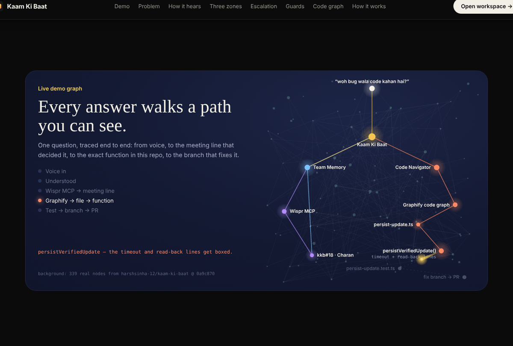
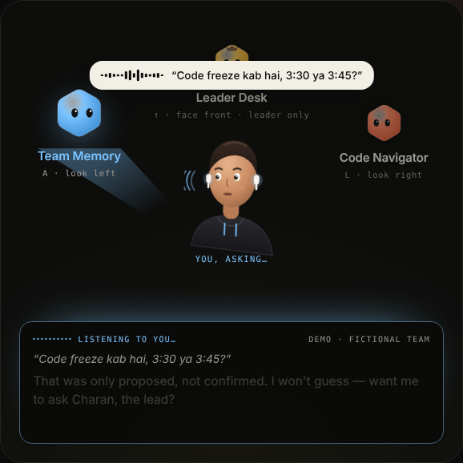
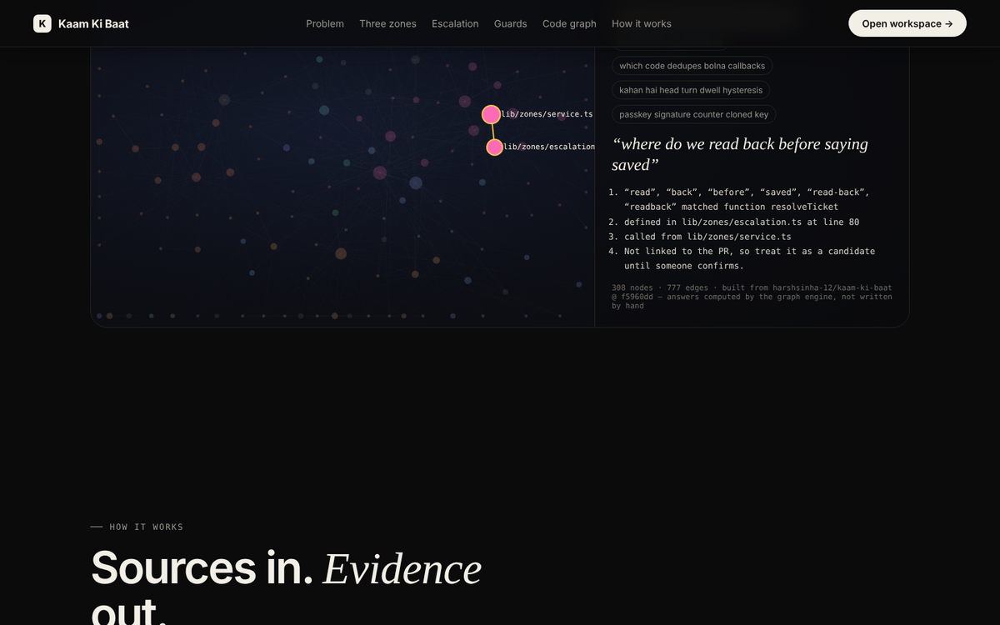
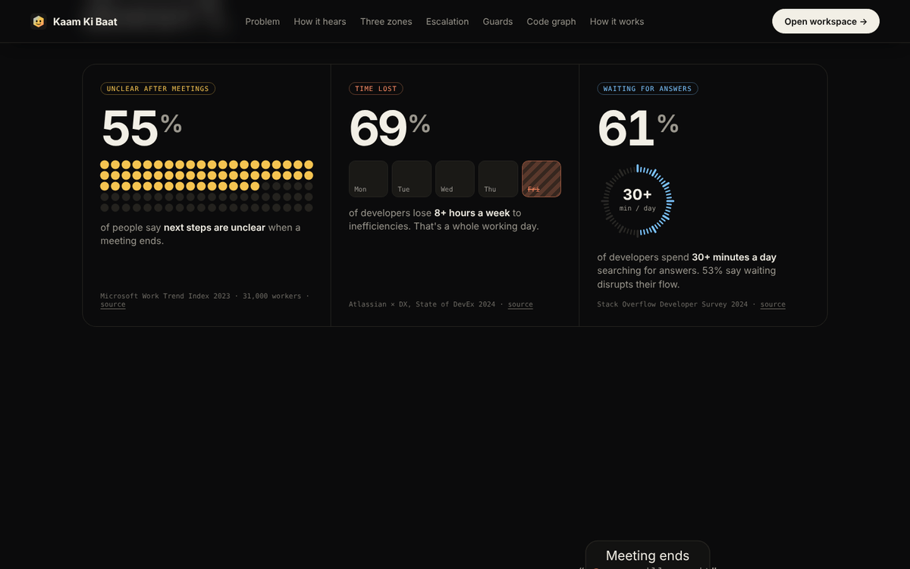

# Kaam Ki Baat

**Meeting mein bola. Repo mein bana?**

Your team's conversations are full of decisions. Your repository is full of changes. **Kaam Ki Baat connects the two—then helps you find what matters, who can confirm it, and where to act.**

[Architecture](docs/architecture.md) · [How it works](#how-it-works) · [Run locally](#run-locally) · [Deployment checklist](docs/deployment-verification.md) · [Build status](docs/plan.md)

> **Hosting status:** The Vercel **Own Track** account has an older project named `kaam-ki-baat` linked to **a different GitHub origin** (`charan-rathore/kaam-ki-baat`). The public site for **this** repository (`harshsinha-12/kaam-ki-baat`) is **not yet verified**. We will add the live-demo link only after its production commit and public accessibility match. See [deployment status and setup](docs/deployment-verification.md). Never treat an illustrated landing-page conversation as proof of a completed Bolna call.



**Demo film (1:15):** [docs/demo/kaam-ki-baat-demo-75s.mp4](docs/demo/kaam-ki-baat-demo-75s.mp4) · [subtitles](docs/demo/kaam-ki-baat-demo-75s.srt) · [source](docs/demo/video-source/)

## The experience

Three agents sit around a teammate. Choose one by a deliberate head turn, with the webcam, or by clicking a card. **Head movement selects an agent; it never authenticates a person or grants permission.**

| Direction | Agent | Why you'd use it |
| :--- | :--- | :--- |
| **← Left** | **Team Memory** | “What did we decide?” See approved meeting evidence, not invented assignments. Escalate unanswered questions to the leader. |
| **↑ Center** | **Leader Desk** | “Can we confirm this?” Leader-only, role-checked decisions, conditional approvals and source-linked changes. |
| **Right →** | **Code Navigator** | “Where does it live?” See the repository, pinned SHA, relevant file, function, lines and regression test. |




### Gestures and controls

| Input | Behavior | Requirement |
| :--- | :--- | :--- |
| Look or turn **left** | Select Team Memory | Calibrated webcam or compatible native AirPods motion |
| Face **front** | Select Leader Desk | Leader account required for privileged actions; head pose is **not** identity |
| Look or turn **right** | Select Code Navigator | Repository access required for code evidence |
| **A** / left arrow, **↑**, **L** / right arrow, or click | Select an agent manually | Works without camera or AirPods |
| Speak | Ask the active agent a question | Explicit audio/microphone consent and a configured voice runtime |

AirPods orientation uses Apple's native Core Motion APIs and compatible hardware; ordinary browser Bluetooth audio does **not** expose AirPods head tracking. Webcam selection and a manual fallback are separate paths. Physical AirPods verification is tracked in [the build plan](docs/plan.md).

The landing page contains an **illustrative, animated experience**, distinct from real phone or browser-voice sessions. Animation respects `prefers-reduced-motion` in the source. Run the [visual QA steps](docs/deployment-verification.md#animation-and-interaction-qa) before claiming that every animation renders on a deployed browser.

## How it works

```text
ONE authorized Wispr meeting               ONE authorized GitHub repository
       │ read-only MCP                          │ PRs · commits · checks
       └────────────────────┬───────────────────┘
                            ▼
             Permissioned evidence engine
        meeting intent ≠ accepted responsibility
          open PR ≠ merged · old CI ≠ verified
                            ▼
          Versioned task and evidence state
                  ┌─────────┼───────────┐
                  ▼         ▼           ▼
             Team Memory  Leader Desk  Code Navigator
                  └─────────┼───────────┘
                            ▼
            Bolna voice + protected HTTP tools
                            ▼
             Verified read-back and audit
```

[Detailed architecture](docs/architecture.md) · [Wispr/Bolna integration boundaries](docs/integration-design.md) · [Spatial live-context design](docs/spatial-live-context-v2.md)



### What the integrations actually do

- **Wispr Flow** supplies **reviewed, consented meeting context** through read-only MCP. The documented MCP is not a continuous per-device microphone stream.
- **GitHub** provides repository evidence at a pinned commit. PR merge state and CI check SHA are evaluated separately.
- **Bolna** powers voice sessions; its management MCP is separate from the application's protected runtime HTTP tools. See [agent setup](docs/bolna/agent.md).
- **Spatial inputs** choose a logical agent. Native AirPods head tracking, webcam-based head pose and keyboard/mouse controls are separate providers.
- **Our evidence engine** records approved revisions and verified task updates. It preserves a distinction between a tool completing work and the result actually being communicated.


## Product walkthrough

The source-based scenario is intentionally straightforward:

1. A teammate asks, **“Code freeze kab hai—3:30 ya 3:45?”** Team Memory should distinguish a *proposal* from a *confirmed decision*.
2. When no confirmed answer exists, the teammate can request leader clarification rather than receiving a guess.
3. An authenticated leader reviews and approves an exact answer, including conditions. A successful save requires a persisted read-back.
4. The teammate can ask where the relevant implementation lives. Code Navigator returns a SHA-pinned file, function and test.

**Important:** The landing-page walkthrough uses illustrative example data. Actual Wispr imports, leader escalations, Bolna tool execution, hardware input and testing evidence are tracked individually in [docs/plan.md](docs/plan.md) and [docs/integrations.md](docs/integrations.md). A screenshot is not proof of a live external integration.

### Evidence, not just transcripts



A practical team problem: decisions are spoken once, then reconstructed across notes, issues, code reviews and chat. When sources disagree, the cost is repeated questions and incorrect assumptions. Kaam Ki Baat is designed to show **what was proposed, what was approved, what was implemented and what was verified**—without treating any of those states as interchangeable.

## Explore the repository

| Area | What is here |
| :--- | :--- |
| [`app/landing/`](app/landing) | Storytelling landing page and motion design |
| [`app/team/`](app/team) | Team Memory experience |
| [`app/leader/`](app/leader) | Leader review and approval interface |
| [`app/graph/`](app/graph) | Interactive code graph |
| [`app/story/`](app/story) | A visual history of the repository's work |
| [`app/components/`](app/components) | Agent selection, spatial controls, code focus and visual components |
| [`lib/`](lib) | Evidence, authorization, specialist routing and tool contracts |
| [`native/airpods/`](native/airpods) | Native AirPods companion and hardware test instructions |
| [`tests/`](tests) | Deterministic and integration-oriented regression tests |
| [`docs/plan.md`](docs/plan.md) | Single source of truth for current project status |


## Run locally

**Requirements:** Node.js 20 or later and npm. Clone this repository, then:

```bash
git clone https://github.com/harshsinha-12/kaam-ki-baat.git
cd kaam-ki-baat
npm ci
npm run typecheck
npm test
npm run build
npm run dev
```

Open [http://localhost:3000](http://localhost:3000). The public landing page, `/story` and `/graph` can render without private integration credentials. For protected team/leader actions and Bolna calls, configure server-side settings according to [`.env.example`](.env.example) and [the workspace setup guide](docs/workspace-setup.md). Never commit secrets, private meetings or phone numbers.

## Publish on Vercel

**Target:** Vercel team **Own Track**, source repository **`harshsinha-12/kaam-ki-baat`**, branch **`main`**.

The existing Own Track project uses a different GitHub origin; don't reuse it as though it contains this repository. First grant the Vercel GitHub App access to `harshsinha-12/kaam-ki-baat`, then create a project from that repository. See [deployment setup and public-access verification](docs/deployment-verification.md).

After a deployment is created, verify its source using:

```bash
npm run deploy:check -- https://YOUR-PROJECT.vercel.app <expected-full-commit-sha>
```

This checks public routes and `/api/deployment-info` for commit parity. It is **not** a visual animation test; perform the browser QA below as well.

[Deploy your own copy](https://vercel.com/new/clone?repository-url=https%3A%2F%2Fgithub.com%2Fharshsinha-12%2Fkaam-ki-baat&project-name=kaam-ki-baat&repository-name=kaam-ki-baat) · [Own Track deployment instructions](docs/deployment-verification.md)

## Demo and evaluation

The hackathon demo is distinct from a qualifying real voice call. The evaluation plan requires three consenting calls **each strictly over 45 seconds** and a documented improvement supported by actual execution logs. We do not substitute fictional landing-page transcripts or motion demos for real call evidence.

[Competition requirements](docs/competition.md) · [Evaluation pipeline](docs/evaluation-pipeline.md) · [Demo notes](docs/demo/meeting-notes.md)

## Building with Claude and Codex

Read [`AGENTS.md`](AGENTS.md) and [`CLAUDE.md`](CLAUDE.md) before changing code. Keep [`docs/plan.md`](docs/plan.md) updated after meaningful milestones. Make small, reviewable pull requests; don't claim a provider works without a real observed request.

## Credits

Inspired by the **spatial interaction philosophy** of [Air Agents](https://github.com/ahmedfahim21/Spatial-Agents): specialized agents selected through deliberate head motion, with shared context. Our application uses its own permissioned evidence engine, Wispr and Bolna integrations, and GitHub code navigation.

**Kaam Ki Baat** — *Meeting mein bola. Repo mein bana?*
