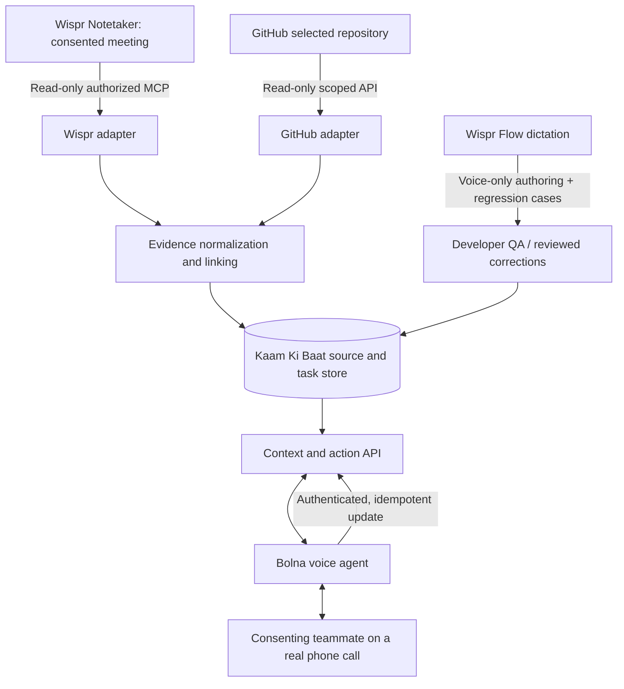

> Planning reference adapted from the user-supplied handoff on 2026-11-15. Project naming has been updated. This is design intent, not implemented behavior. Current user instructions and [the active plan](../plan.md) take precedence.

> The required developer connections now include Bolna AI MCP and Wispr Flow MCP; see [current integration notes](../integrations.md). Connecting MCP tools to the coding client does not automatically connect the future telephone agent to Wispr or our task store.

# Architecture — simple, inspectable, versioned

## Trust boundaries
- **Meeting evidence:** read through Wispr MCP only after user authorization. Select a particular consented meeting; avoid disclosing private notes to unapproved call participants.
- **Repository evidence:** read only the designated repo using lowest required permissions. A meeting mention of an issue number is a candidate link, not proof of identity.
- **LLM output:** generated task / file matches are hypotheses. Deterministic business logic controls status classifications and writes.
- **Caller:** distinguish phone number from verified identity. For demo, invite consenting known participants and pre-associate their phone numbers with restricted project roles; identity uncertainty must block disclosure of secrets.
- **Persistence:** maintain an append-only revision/audit log with actor, evidence, timestamp and verification status.
- **Webhooks:** authenticate, verify signature according to provider docs, use idempotency keys, and never log credentials. Verify saved postconditions before claiming success.

## Pipeline
1. `ingest_meeting(meeting_id)` -> read bounded transcript (possibly paged), store source spans and tags; no assumed assignments.
2. `fetch_repo_context(repo, selected_issue_or_pr)` -> issue body, selected PR metadata/diff, commit SHA, current CI checks.
3. `reconcile(evidence)` -> links to tasks; `confirmed` only with explicit source/acceptance; uncertainty remains visible.
4. `brief_for(participant)` -> strictly scoped 2–3-sentence useful starting brief + suggested follow-up.
5. Bolna voice agent calls `get_my_brief`, `get_task_evidence`, `get_changes`, `record_task_update` via HTTP functions.
6. Verified mutation persisted. A post-call summary stores call ID, consent flag, duration, version and outcome.

## Freshness & version rules
- Each GitHub claim stores repo URL, branch and immutable commit SHA, fetched_at, and check run SHA.
- Re-query before asserting a PR is merged or a check is current. "Test passed" is valid only for the exact tested SHA.
- Meeting facts include source meeting ID, transcript span and authorship.
- If source is stale/missing/ambiguous: say "I can't verify that yet." Propose a follow-up; never invent.

## Suggested deployment
- **Default:** one Next.js TypeScript application with API route handlers, Zod schemas, and Supabase/Postgres for remotely accessible durable storage. This is a proposal, not an installed dependency.
- **Simpler offline prototype:** in-memory/synthetic fixtures first, then local SQLite for demonstration and development; a public HTTPS callback/tunnel is needed for remote Bolna tools. Confirm webhook reachability before building UI.
- Do not build a new MCP server for the MVP. Build a narrow MCP client adapter and a separate HTTP adapter for Bolna functions.
