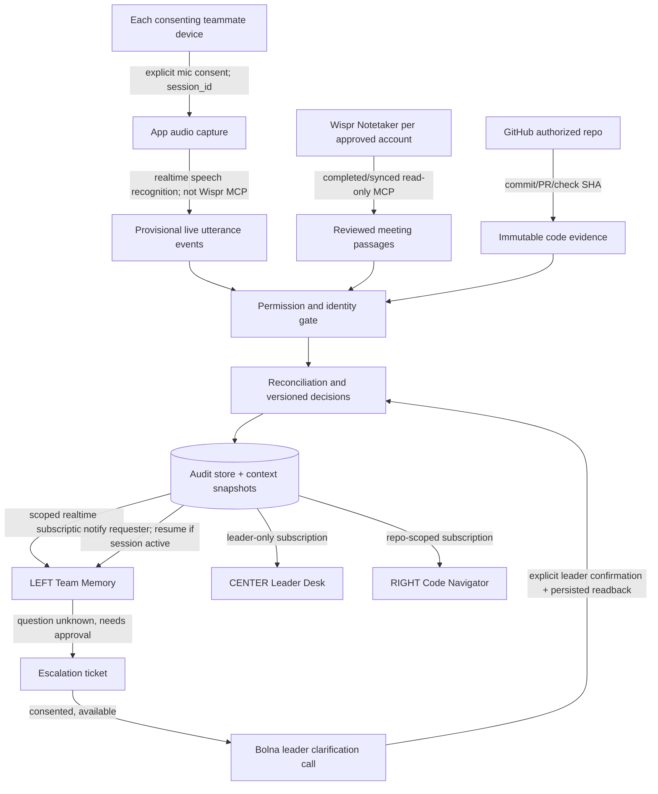

# Spatial Live Context v2 — three physical interaction zones

**Status: proposed design, NOT implemented or validated.** Requested 2026-11-15. This is a reviewable architecture proposal, not permission to deploy, record audio, make calls, or merge.

## 0. Critical feasibility truths

1. Air Agents (https://github.com/ahmedfahim21/Spatial-Agents) uses Apple native `CMHeadphoneMotionManager` for AirPods motion and `AVAudioEnvironmentNode` for spatial sound. A generic Bluetooth headset/browser **does not** expose this interface. OS Bluetooth audio is supported, but it is NOT headset motion.
2. Web MVP: explicitly permissioned webcam + on-device face landmarks/pose (e.g. MediaPipe Face Landmarker). Yaw-based head-turn selection; not precise eye-gaze or biometric identity. Camera OFF by default, no frame uploads, calibrate neutral pose, debounce, dwell, hysteresis, recovery and keyboard/tap fallback.
3. Leader authentication: verified account role AND fresh WebAuthn user-verification/passkey for entering leader-only actions. A camera seeing a face or someone looking forward is NEVER proof of leader identity. The browser does not reveal a face identity from the passkey.
4. Wispr Notetaker shows a live transcript locally but its documented read-only remote MCP provides searchable meetings/notes/transcripts, NOT a low-latency push stream or live dictation history. Do not claim a continuous per-device live Wispr MCP feed. Use a distinct consented application live-STT lane for real-time context; reconcile it with reviewed Wispr meeting evidence after sync/completion.
5. Each teammate independently opts in. Team-wide sharing is a separate user-controlled choice. No omniscient shared microphone; unauthorized device content is inaccessible.

## 1. Three activation zones

| Spatial zone | Agent | Eligibility | Wake condition | Allowed action |
| --- | --- | --- | --- | --- |
| LEFT | Team Memory | authorized team members | calibrated left head-turn dwell + explicit activation | answers approved decisions, timelines, ownership with evidence; opens escalation when unknown |
| CENTER | Leader Desk | authenticated leader only | leader passkey/session plus centered gaze/head pose and explicit activation | approves/refutes decisions, assigns ownership, answers escalation; privileged changes need explicit confirmation |
| RIGHT | Code Navigator | repo-authorized teammates | calibrated right head-turn dwell + explicit activation | opens approved repo at exact commit SHA, highlights source file/function/lines and test; suggests fix, NO unattended edit |

**Head orientation ≠ eye gaze.** Avoid the phrase `just look to camera to prove you're the leader`. A camera pose is only selection. For AirPods head motion, a later native Apple iOS/macOS companion can call CoreMotion and send a signed low-privilege `focus_changed` event. Do not fake Web Bluetooth support for this.

## 2. Sources, provenance and updates

- Live lane: each authenticated device sends *finalized* incremental utterances tagged with participant_id, device_id, session_id, sequence, local timestamp, server timestamp, language, consent receipt, visibility and source=`app_live_stt`. Do not persist ambient raw audio by default.
- Wispr lane: ingest only expressly selected meetings through an OAuth MCP client. Keep meeting_id, speaker, transcript span, modification time and source=`wispr_mcp`. Wispr meeting source is eventual/reviewed, not proof of current speech timing.
- Repo lane: inspect selected GitHub repository at immutable commit SHA; attach PR state and same-SHA CI check evidence.
- Reconcile: speaker/meeting evidence + current repo evidence + scoped live events are not interchangeable. A provisional utterance never auto-overwrites an approved decision.
- Sync: dedupe by source event ID/session sequence; events idempotent on reconnect; append-only provenance and context version. Distinguish `captured`, `transcribed`, `reviewed`, `approved`, `superseded` and `unavailable`.

## 3. Unknown answer → leader escalation → return

1. Left agent searches *authorized approved context*. If unanswered, state `I don't have a confirmed answer` and present an escalation request.
2. Requester explicitly approves sending a minimal question and approved reference context to the leader. Create `clarification_id` and `pending` record; no transcript dump.
3. Leader chooses/responds via their private desk; optional Bolna outbound call only with explicit leader consent and availability. Verify caller/leader on server. Do not automatically call unavailable or unconsenting leaders.
4. Leader confirms exact answer/conditions. Commit updated decision state with `approved_by`, `approved_at`, source and context_version only after successful authenticated write/readback.
5. Notify the original requester. If their session remains connected, answer with the new source; otherwise offer opt-in notification/reconnect or callback. Don't promise an indefinitely held Bolna call.
6. If leader is unreachable: ticket stays pending, requester sees status and last approved context. Never guess or quietly replace with LLM speculation.

## 4. Right-side code navigation

Use an app-controlled code viewer or GitHub permalink, not unrestricted browser automation. The backend returns {repo, sha, path, line_start, line_end, source_refs, match_status, related_tests}. UI displays pinned file, highlights exact lines, explains why relevant and offers a next check. If candidate not confirmed, label it. Require repo permission before fetching and rendering. An issue/PR match is not a verified fix.

## 5. Supabase and 0G

Supabase is an optional but useful hosted persistence/event distribution choice: Auth (with passkeys via supported identity flow), Postgres RLS, events, and private Realtime Broadcast; Edge Functions for short authenticated tools. Existing local event-store baseline remains until contract tests pass. Store secrets only server-side and do not broadcast raw transcripts to every member.
0G Compute is optional paid inference; not a route for headset tracking, live Wispr sync, approvals or permission decisions. Model output is advisory only; no source of truth claims.

## 6. Suggested implementation phases

**P0 web demo:** role-based sessions, camera head-pose selector + fallback, LEFT evidence answer, RIGHT pinned code highlight, leader-only CENTER proof gate; one authorized meeting import and selected GitHub repo.
**P1 live context:** opt-in per-device audio, separate STT provider, provenance-tagged incremental events, scoped realtime broadcast, offline/resume/reconciliation, leader escalation ticket; confirm provider billing and privacy first.
**P2 native head-motion:** optional AirPods companion using CoreMotion; hardware availability/permission and latency must be independently tested. No default reliance on Web Bluetooth GATT.

## 7. Non-negotiable acceptance

- Nonleader cannot open Center or leader-only tools even by spoofing camera, focus events, client role, or direct API calls.
- Without camera/Bluetooth permission, all agents still accessible using keyboard/tap controls.
- Without audio consent, microphone remains off and no audio/derived transcript is stored.
- Member A cannot retrieve Member B's private utterances or an unapproved meeting; enforce server-side RLS/tool permissions.
- Wispr MCP delayed/unavailable state is displayed truthfully; live app STT can be labeled `provisional` but never masquerades as Wispr MCP.
- Unknown question creates a ticket, not an invented answer; leader's approval must be verified and requester gets linked clarification.
- An escalation call that ends or fails leaves an auditable outcome; queued information is not silently dropped.
- Browser code highlights are anchored to the exact SHA; stale code/checks say stale.
- Replay repeated/transient network events without duplicate approved decisions or writes.
- Separate tests for gesture false triggers, lighting loss, accessibility fallback, Bluetooth disconnect, camera pause, device clock skew, echo/double capture, speaker attribution, interruption and resume.

**Source references:** Air Agents repo; Apple CMHeadphoneMotionManager; Google MediaPipe Face Landmarker; MDN Passkeys and Web Bluetooth; Wispr official MCP and Notetaker documentation; Supabase Realtime private Broadcast.